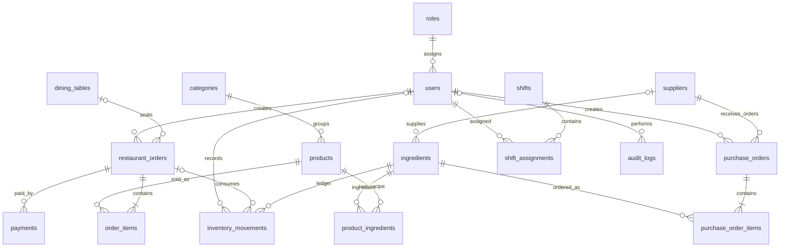

# Project NOAH POS — ERD (logical relationships)

The ERD is logical; `product_ingredients` and `shift_assignments` are associative tables. `inventory_movements` is the stock ledger. Current ingredient stock is maintained through the ledger trigger so every incoming/outgoing change has a traceable reason and timestamp.
